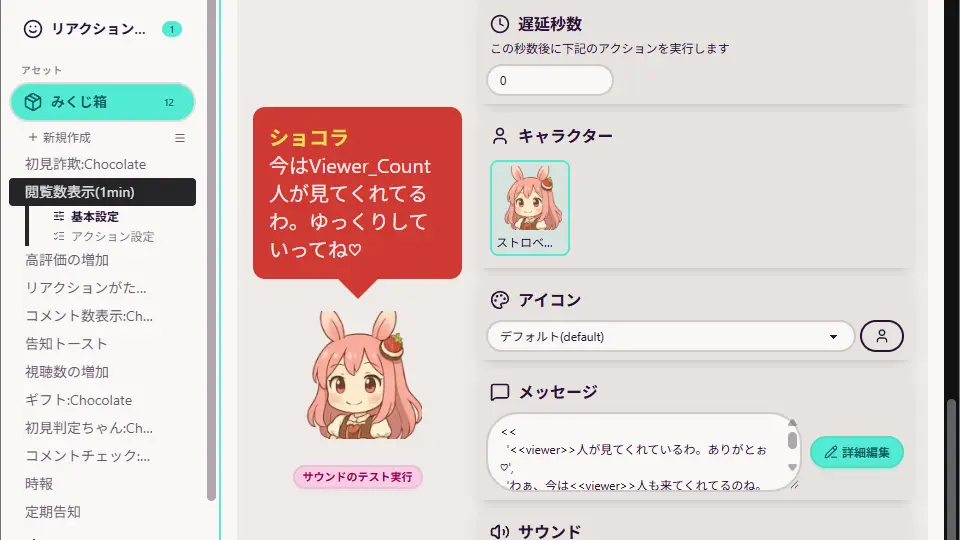
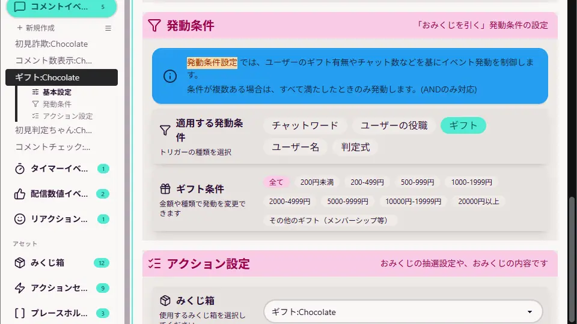

# おみくじBOT エディター OmikujiBot editor

最終更新日：2026/11/26

配信者のためのコメントアプリ「わんコメ」で使用できる、

 ジェネレーター BOT 「おみくじBOT」のデータを編集できるアプリケーションです。

この内容は、BOOTH または Github で配布している、

 下記に同梱している 「おみくじBOT エディター」 の readme となります。

- [おみくじBOT ストロベリーショコラ OmikujiBot StrawberryChocolate](https://pintocuru.booth.pm/items/7733810)

## はじめに（Intro）

- [わんコメ](https://onecomme.com/) の機能を前提としたソフトウェアです。
- 本ソフトウェアの利用は自己責任でお願いいたします。
- 仕様は予告なく変更される場合があります。

## このアプリは何？（Features）

### おみくじBOT を自分好みに設定できる、専用エディター

【おみくじBOT エディター OmikujiBot editor】は、[おみくじBOT](/core/OmikujiBot/README.md) 専用のエディターです。おみくじの内容や演出を、直感的にカスタマイズできます。

1. **おみくじの確率や制限が自由に行える**
   - おみくじの内容や、演出のタイミングを自由に変更可能
   - 出現確率も自由に設定可能、パチスロのような 1/65536 にも
   - 「メンバー限定」「ギフト」など、発動条件を自由に設定
   - 引ける回数を制限（例：1 日 1 回、連投制限）
2. **多彩なおみくじ結果をサポートする「プレースホルダー」機能**
   - 抽選の重さを使った簡易設定から、プレースホルダー機能を使った高度なおみくじまで対応
   - 1000 通り以上の複雑なおみくじも簡単に作成
   - プレースホルダー設定の「テキストモード」で、大量データも楽に入力
3. **フキダシのカラーやスタイルを変更できる**
   - フキダシ色やアニメーションの変更を、エディター内で動作確認
4. **シンプルにも賑やかにもできるキャラクター関連**
   - キャラクター画像が使えます。自作画像の使用も可能！
   - キャラクターごとに読み上げを変えられます
5. **プラグインを使ってもっと使いやすく**
   - プラグインを使うことで、複数のデータを管理可能

## インストール (Installation)

### [1. おみくじBOT のアップグレード / おみくじBOT エディターの新規導入](../../template/jp/installation/Installation_52_VersionUp.md)

- おみくじBOT エディターは、一部のおみくじBOT のパッケージに付属しています。
- 付属していない場合でも、無料で おみくじBOT エディターの導入が可能です。

## つかいかた (Usage)

おみくじデータに関する設定方法は、それぞれエディターに詳細が書かれています。現在も開発中であり、機能が多岐にわたるため、すべてをこの README に記載することはしていません。

**基本的な使い方のヒント**：

- エディターを開くと、各項目にツールチップや説明が表示されます
- 設定項目は直感的に操作できるように設計されています

### 【重要】 設定の保存方法

- おみくじBOT プラグインを導入することで、途中保存を行えるようになります。無料です！
- 導入方法は [おみくじBOT プラグイン README](/core/EditorPlugin/README.md) をご覧ください。

おみくじBOT プラグインを導入しない場合、おみくじBOT エディターは途中の保存が行えません。閉じたりリロードすると内容が消えてしまうため、保存は注意深く行ってください。

**内容の反映のさせ方**

1. 「設定を出力 (js)」ボタンを押すと、ブラウザから「omikujiData.js」というファイルが保存されます。
2. おみくじBOT エディターと同じフォルダに、ダウンロードした「omikujiData.js」を上書き保存します。

## よくある質問 (FAQ)

> わんコメの機能については [よくある質問](https://onecomme.com/docs/faq) または [導入ガイド](https://onecomme.com/docs/guide) をご参照ください。

### 発動条件・制限設定

- [Q. ギフト・スパチャされた時にだけ発動させたい](/template/jp/faq/21_LimitEdit/faq_2101_Gift.md)
- [Q. メンバー限定で発動させたい](/template/jp/faq/21_LimitEdit/faq_2102_Member.md)
- [Q. 1ユーザーにつき、1 日 1 回と、回数を制限したい](/template/jp/faq/21_LimitEdit/faq_2103_Limit.md)
- [Q. 配信者をおみくじから外すには？](/template/jp/faq/21_LimitEdit/faq_2104_Owner.md)
- [Q. 特定のおみくじを、一時的にオフにしたい](/template/jp/faq/21_LimitEdit/faq_2105_OffOmikuji.md)
- [Q. 特定のユーザーを制限したい](/template/jp/faq/21_LimitEdit/faq_2107_LimitOther.md)

### フキダシ・キャラクター表示関連

> キャラクターに関する扱いについては、各パッケージごとに異なります。

- [Q. 文字やキャラクターのサイズを調整したい](/template/jp/faq/22_Character/faq_2205_FontBig.md)
- [Q. 自前のキャラクター画像を追加したい](/template/jp/faq/22_Character/faq_2206_MyCharacter.md)
- [Q. おみくじ結果で表示されるキャラクター・アイコンを変更したい](/template/jp/faq/22_Character/faq_2207_CharacterChange.md)
- [Q. ジェネレーターで表示するキャラクターを変更する](/template/jp/faq/22_Character/faq_2208_AlwaysCharacter.md)

### おみくじ内容・確率設定（コンテンツ編集）

- [Q. おみくじの内容を変更したい](/template/jp/faq/23_OmikujiEdit/faq_2301_OmikujiValue.md)
- [Q. おみくじが出てくる確率を変更したい](/template/jp/faq/23_OmikujiEdit/faq_2302_Omikujilottery.md)
- [Q. エディターで、おみくじの動作を確認するには](/template/jp/faq/23_OmikujiEdit/faq_2303_OmikujiConfirmation.md)
- [Q. プレースホルダーでおみくじのバリエーションを増やす](/core/ConfigEditor/sub/ContentPlaceholder.md)
- [Q. プレースホルダー チートシート](/core/ConfigEditor/sub/ContentPlaceholderCheatSheet.md)
- [Q. 評価ブロックとは](/core/ConfigEditor/sub/VariablePlaceholder.md)
- [Q. 評価ブロック チートシート](/core/ConfigEditor/sub/VariablePlaceholderCheatSheet.md)
- [Q. おみくじ表示時、好きなサウンドを鳴らすには](/template/jp/faq/23_OmikujiEdit/faq_2304_OmikujiSound.md)
- [Q. おみくじ表示時にWordpartyを鳴らす](/template/jp/faq/23_OmikujiEdit/faq_2305_OmikujiWordparty.md)

### エディター関連

#### Q. 元に戻す（Undo）はできる？

A. Undo 機能は付いていません。こまめに保存していただくようお願いします。

#### Q. 作成したデータを他の人と共有できますか？

A. 配布データをそのまま再配布することは禁止です。内容を編集し、配布データにない要素を付与した json データについては、配布できる場合があります。詳しくは Readme をお読み下さい。

#### Q. 最新のバージョンより古いデータで作成したファイルは読めますか？

- v2の最新ファイルは読めますが、一部データが変更されているため、修正してください
- それ以前 のデータは互換性がないため、読み込むことはできません。

## トラブルシューティング (Troubleshooting)

### Q. データを記入したのに、ジェネレーターに反映されていない

- このおみくじBOT エディターは、自動保存ではありません。
- 保存ボタンを押し、出力されたファイルを上書きする方法で保存を行う必要があります。
  - 詳しくはつかいかた (Usage) の、【重要】 設定の保存方法をご覧ください。
- 専用の「おみくじBOT プラグイン」を併用することで、保存作業を大幅に簡略化できます。

## クレジット・ライセンス（Credits/License）

### デザイン・カラーリング

- TailwindCSS <https://tailwindcss.com/> - MIT License
- DaisyUI <https://daisyui.com/> - MIT License

### UI 向けアイコン

- Lucide Icons <https://lucide.dev/> - MIT License

### プレビューのアイコン

- DiceBear <https://www.dicebear.com/>
  - [Thumbs](https://www.dicebear.com/styles/thumbs/) - CC0 1.0
  - [Bottts](https://www.dicebear.com/styles/bottts/) - "Free for personal and commercial use"
  - [Lorelei](https://www.dicebear.com/styles/lorelei/) - CC0 1.0
  - [Notionists](https://www.dicebear.com/styles/notionists/) - CC0 1.0
  - [Open Peeps](https://www.dicebear.com/styles/open-peeps/) - CC0 1.0
  - [Pixel Art](https://www.dicebear.com/styles/pixel-art/) - CC0 1.0

## ライセンス（License）

### アプリ本体（ジェネレーター・エディター・プラグイン）

- Copyright © 2023-2027 Pintocuru(せすじピンとしてます)
- 本ソフトウェア（おみくじBOT）は Apache License 2.0 の下で提供されています。
- ライセンスの条件に従う限り、本ソフトウェアの利用、複製、改変、再配布、および商用利用が可能です。
- 公式の配布場所は、GitHub、または BOOTH で提供される各パッケージです。
- パッケージに含まれるデータ・イラスト・音源は、本ライセンスの対象外です。各パッケージのライセンスをご確認ください。
- 本ソフトウェアは現状のまま（AS IS）提供されており、明示または黙示を問わず、いかなる保証も行いません。

### 効果音

- 効果音には CC0 ライセンスの素材を使用しています。
- 詳細は おみくじBOT 本体のクレジット をご確認ください。

### パッケージデータ

パッケージごとにライセンス形態（商用利用可否・改変可否など）が異なります。詳しくは各パッケージの README または商品ページをご確認ください。

## バージョン情報

> 詳細な変更履歴は [Releases](https://github.com/Pintocuru/OmikujiBot-Docs/releases) をご覧ください。

---

作成者：Pintocuru(せすじピンとしてます) @pintocuru

[Twitter](https://twitter.com/pintocuru) | [YouTube](https://www.youtube.com/@pintocuru)
