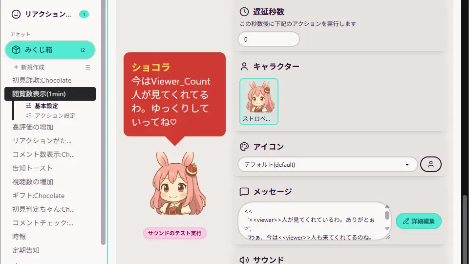
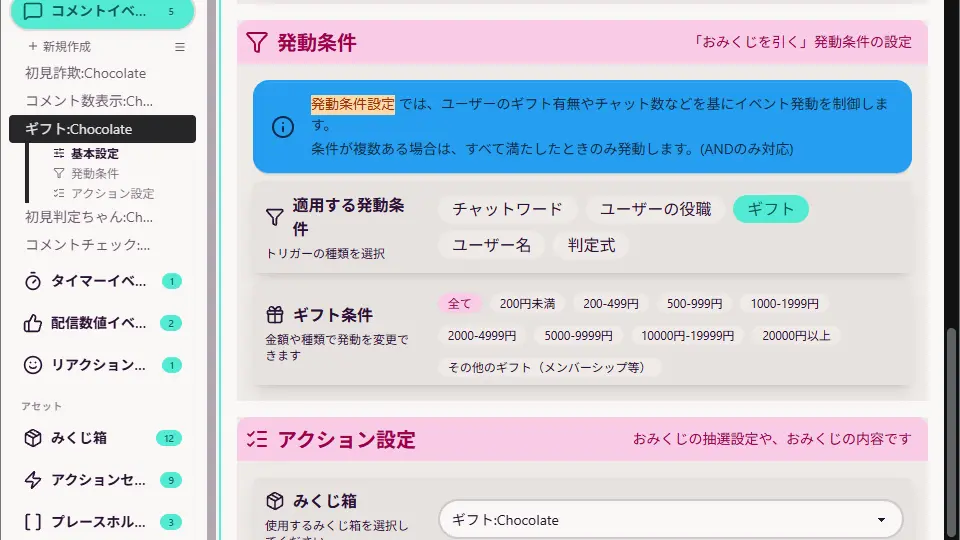

# おみくじBOT エディター OmikujiBot editor

最終更新日：<% tp.date.now('YYYY/MM/DD') %>

配信者のためのコメントアプリ「わんコメ」で使用できる、ジェネレーター BOT 「おみくじBOT」のデータを編集できるアプリケーションです。

本 README は、BOOTH または GitHub で配布している、おみくじBOTのパッケージに同梱された「おみくじBOT エディター」の説明書です。

## はじめに（Intro）

## このアプリは何？（Features）

### おみくじBOT を自分好みに設定できる、専用エディター

【おみくじBOT エディター OmikujiBot editor】は、[おみくじBOT](/core/OmikujiBot/README.md) 専用のエディターです。おみくじの内容や演出を、直感的にカスタマイズできます。

1. **おみくじの確率や発動条件、回数制限を自由に設定できる**
   - おみくじの内容や、演出のタイミングを自由に変更可能
   - 出現確率も自由に設定でき、パチスロのような 1/65536 の確率も設定可能
   - 「メンバー限定」「ギフト」など、発動条件を自由に設定
   - 引ける回数を制限（例：1 日 1 回、連投制限）
2. **多彩なおみくじ結果をサポートする「プレースホルダー」機能**
   - 抽選の重さを使った簡易設定から、プレースホルダー機能を使った高度なおみくじまで対応
   - 1000 通り以上の複雑なおみくじも簡単に作成
   - プレースホルダー設定の「テキストモード」で、大量データも楽に入力
3. **フキダシのカラーやスタイルを変更できる**
   - フキダシ色やアニメーションの変更を、エディター内で動作確認
4. **キャラクターの表示や読み上げもカスタマイズ**
   - キャラクター画像が使えます。自作画像の使用も可能！
   - キャラクターごとに読み上げを変えられます
5. **プラグインを使ってもっと使いやすく**
   - プラグインを使うことで、複数のデータを管理可能

## インストール (Installation)

### [1. おみくじBOT のアップグレード / おみくじBOT エディターの新規導入](../../template/jp/installation/installation_VersionUp.md)

- おみくじBOT エディターは、一部のおみくじBOT のパッケージに付属しています。
- 付属していないパッケージでも、おみくじBOT エディターを無料で導入できます。

## つかいかた (Usage)

おみくじデータの設定方法については、エディター内に各項目の説明を用意しています。機能が多岐にわたるため、本 README ではすべての設定方法を解説していません。

**基本的な使い方のヒント**：

- エディターを開くと、各項目にツールチップや説明が表示されます
- 設定項目は直感的に操作できるように設計されています

### 【重要】 設定の保存方法

- おみくじBOT プラグインを導入すると、編集中のデータを途中保存できます。無料で導入できます！
- 導入方法は [おみくじBOT プラグイン README](/core/EditorPlugin/README.md) をご覧ください。

おみくじBOT プラグインを導入していない場合、編集中のデータを途中保存できません。エディターを閉じたり、ページをリロードしたりすると編集内容が消えるため、ご注意ください。

**設定内容の反映方法**

1. 「設定を出力 (js)」ボタンを押すと、ブラウザから「omikujiData.js」というファイルが保存されます。
2. おみくじBOT エディターと同じフォルダに、ダウンロードした「omikujiData.js」を上書き保存します。

### エディター関連

#### Q. 元に戻す（Undo）はできる？

A. Undo 機能はありません。こまめに保存することをおすすめします。

#### Q. 作成したデータを他の人と共有できますか？

A. 配布データをそのまま再配布することは禁止です。内容を編集し、配布データにない要素を付与した json データについては、配布できる場合があります。詳しくは Readme をお読み下さい。

#### Q. 最新のバージョンより古いデータで作成したファイルは読めますか？

- v2の最新ファイルは読み込めますが、一部のデータが変更されているため、修正が必要です。
- それ以前のデータには互換性がないため、読み込めません。

## トラブルシューティング (Troubleshooting)

### Q. データを記入したのに、ジェネレーターに反映されていない

- おみくじBOT エディターは自動保存されません。
- 「設定を出力 (js)」ボタンを押して出力したファイルを、元のファイルに上書き保存する必要があります。
  - 詳しくは「つかいかた (Usage)」の「【重要】設定の保存方法」をご覧ください。
- 専用の「おみくじBOT プラグイン」を併用すると、保存作業を大幅に簡略化できます。
  - [おみくじBOT ManagerPlugin の README](../../core/ManagerPlugin/README.ja.md)

## クレジット・ライセンス（Credits/License）

### デザイン・カラーリング

- TailwindCSS <https://tailwindcss.com/> - MIT License
- DaisyUI <https://daisyui.com/> - MIT License

### UI 向けアイコン

- Lucide Icons <https://lucide.dev/> - MIT License

### プレビューのアイコン

- DiceBear <https://www.dicebear.com/>
  - [Thumbs](https://www.dicebear.com/styles/thumbs/) - CC0 1.0
  - [Bottts](https://www.dicebear.com/styles/bottts/) - "Free for personal and commercial use"
  - [Lorelei](https://www.dicebear.com/styles/lorelei/) - CC0 1.0
  - [Notionists](https://www.dicebear.com/styles/notionists/) - CC0 1.0
  - [Open Peeps](https://www.dicebear.com/styles/open-peeps/) - CC0 1.0
  - [Pixel Art](https://www.dicebear.com/styles/pixel-art/) - CC0 1.0

## ライセンス（License）

### アプリ本体（ジェネレーター・エディター・プラグイン）

### 効果音

### パッケージデータ

## バージョン情報

<%* await tp.user.expandEmbeds(tp,'ja') %>
