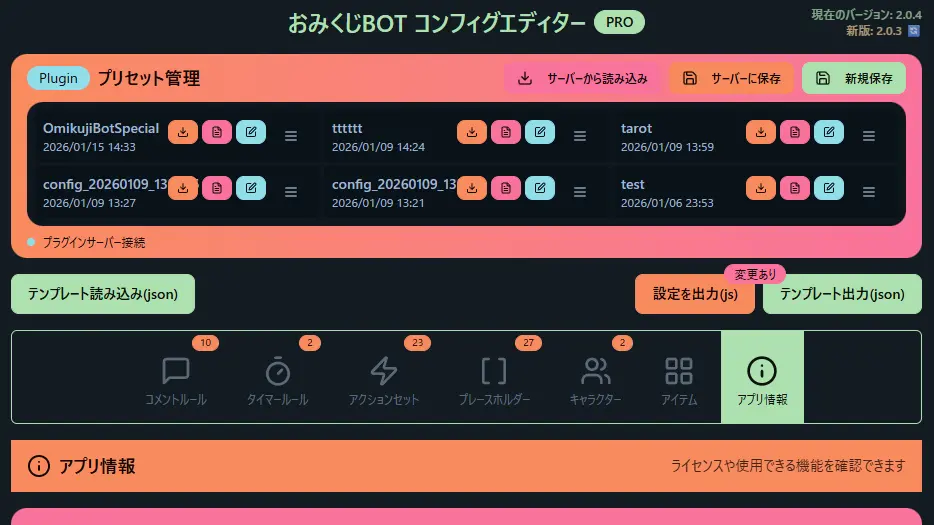
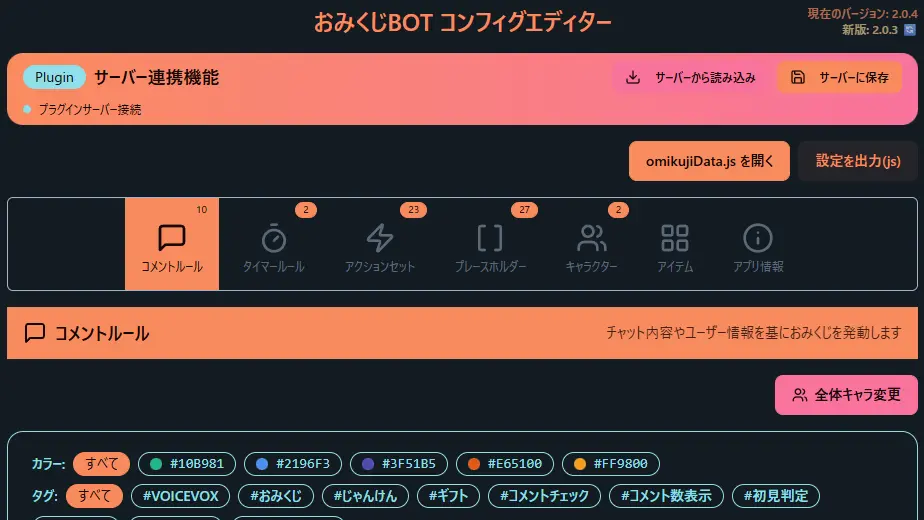
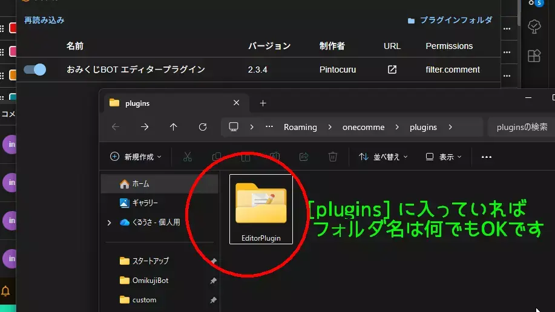

# OmikujiBot Plugin (OmikujiBot EditorPlugin)

Last updated: <% tp.date.now('YYYY/MM/DD') %>

 a companion plugin for "OmikujiBot".

## What is this plugin? (Features)

### An extension plugin that makes creating omikuji much easier and supports the whole series

- "OmikujiBot Plugin" makes use of OneComme's plugin feature to add file loading and saving.
- It is used with OmikujiBot Editor (`editor.html`), which is bundled with the "OmikujiBot" series.
- It enables "loading JSON files", which was previously impossible due to browser restrictions, and lets you save with a single button.

### Greatly improves the editing efficiency of "OmikujiBot"

- **Edit on the spot and see changes immediately, without moving files around**
  - The generator also refers to this plugin, so your edits are reflected right away.
- **"Preset Management" for managing multiple setting files together**
  - You can use the "Preset" feature to switch between and manage multiple datasets.

## Installation

- [Installing the plugin in OneComme](../../template/en/installation/Installation_93_PluginSet.md)

## Usage

### Server Integration

- When the plugin is installed successfully, OneComme posts the announcement `【OmikujiBot Plugin】 has started` (the actual message is shown in Japanese).
- If you launch **OmikujiBot Editor** in this state, a dedicated bar appears and the following features become available.
  - **Load from server** (shown when data has already been saved on the generator side)
  - **Save to server**
- If data has already been saved to the server, **the content shown when the editor starts is the data loaded from the server.**
  - If no data exists on the server, **the local** `omikujiData.js` **is loaded.**
- Once you save data with "Save to server", the generator loads that data with priority.

### Preset Management

A handy management tool for people who want to switch between multiple sets of omikuji data.

- Useful when you want to use different omikuji data depending on the stream content or theme.
- Press "Save as New" to register what is currently shown in the editor as a preset, exactly as it is.

## Frequently Asked Questions (FAQ)

### Q. Where is the data saved with "Save to server"?

- It is saved in `packages` inside the plugin folder.
- The file name is the same as the **id** under **App Info > Basic Info** in OmikujiBot Editor.
  - Example: if the id is `abc123` → `abc123.json` is saved.

### Q. Where are preset data managed?

- They are saved in `presets` inside the plugin folder.
- The files saved there are listed on the Preset Management screen.

### Q. Can I use it together with the old version (OmikenBOT Plugin)?

- It is not compatible with the old [OmikenBOT Plugin](https://pintocuru.booth.pm/items/6499304 'View product page'). Please use only the new plugin.

## Troubleshooting

### Q. I installed the plugin but no announcement appears

- Check that the plugin folder location is correct.
- You need to put the unzipped folder into the plugin folder **as is**.

### Q. The server integration features are not shown

- The plugin may **not be turned ON**.
  - When it is ON, OneComme displays the message `【OmikujiBot Plugin】 has started`.
- Restarting OneComme may make them appear.
- If they still don't appear, try reloading the plugin.
- Also check that you put the unzipped folder into the plugin folder **as is**.

### Q. The generator doesn't load the edited data

- The "OmikujiBot Plugin" may not be installed correctly, or the plugin may **not be turned ON**.
- Also, if there is data saved on the generator side, it is loaded automatically from the server when the editor starts.
- If it isn't reflected, try pressing **"Load from server"** in the server integration features.

## Version Information

> For the detailed change history, see [Releases](https://github.com/Pintocuru/OmikujiBot-Docs/releases).

<%* await tp.user.expandEmbeds(tp) %>
