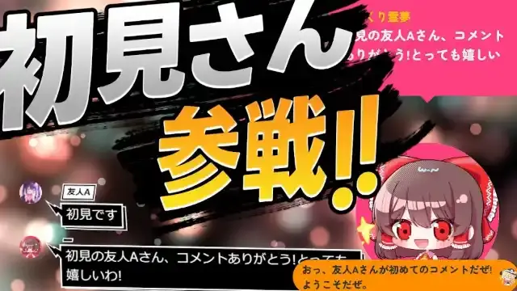
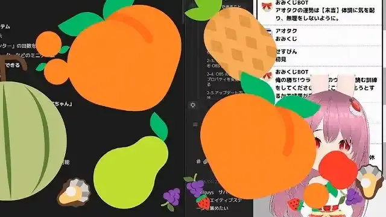

# WordParty 2.0 for OmikujiBot

Last updated: <% tp.date.now('YYYY/MM/DD') %>

 a WordParty template.

- This template can only be used with the "OmikujiBot" series packages below.
- Use the latest version of each. Older versions may not work properly.

## What is this template? (Features)

### A WordParty set that brings OmikujiBot to life

- "WordParty for OmikujiBot" is a set for OneComme's "[WordParty](https://onecomme.com/docs/feature/wordparty)" feature.
- Installing this set makes your stream more colorful and fun to watch.
  - Sound effects and animations are added to the characters' lines.
  - Omikuji results and rock-paper-scissors outcomes are displayed in a visually clear way.
    

## Installation

- WordParty templates can be installed the same way as other generators.
- To send audio to OBS, additional setup is required. For details, see OneComme's official [How to put audio on your stream](https://onecomme.com/docs/feature/wordparty#%E9%9F%B3%E5%A3%B0%E3%82%92%E9%85%8D%E4%BF%A1%E3%81%AB%E3%81%AE%E3%81%9B%E3%82%8B%E6%96%B9%E6%B3%95).

## Usage / Customization

- It is used the same way as existing WordParty. See [Effects triggered by comments - WordParty](https://onecomme.com/docs/feature/wordparty).
- To avoid redistribution, **it cannot be edited in OneComme's WordParty editor**.

## Frequently Asked Questions (FAQ)

For anything about WordParty, see [Effects triggered by comments - WordParty](https://onecomme.com/docs/feature/wordparty).

### Settings

#### Q. Can I use "Shoken-san Sansen" (First-timer Joins the Battle) outside OmikujiBot?

- Some videos, audio, and images are released under [CC0 1.0](https://creativecommons.org/publicdomain/zero/1.0/) and can be used without credit.
- For credits on the materials, see [WordParty for OmikujiBot Credits and Licenses](sub/OmikenWordPartyCredits.md).

#### Q. Doesn't this violate the Sound Effect Lab terms of use?

- The [terms of use](https://soundeffect-lab.info/agreement/) allow using the audio as-is, so we use it as-is.
- Instead, it cannot be edited in OneComme's WordParty editor.
  - Because this makes the IDs and trigger conditions unknown and prevents reuse, we believe it does not count as redistribution of the audio.

## Troubleshooting

### I can't open it in the WordParty editor

A: This is the [specification](https://onecomme.com/docs/feature/wordparty#%E3%81%9D%E3%81%AE%E4%BB%96%E4%BB%95%E6%A7%98). Because of how the WordParty editor works, there is a risk of redistributing the materials, so it is set so that it cannot be opened in the editor.

## Credits / License

- They are compiled in [WordParty for OmikujiBot Credits and Licenses](sub/OmikenWordPartyCredits.md).
- The sound effect data included in this app also includes material that is not Creative Commons.
	- These are either covered by separate terms of use, or are images and videos made exclusively for this app.
	- Use for other purposes, reposting, and redistribution are prohibited.

## Version Information

### v2.0.4 26/01/26

- Added more effects.

### v1.4.0 25/11/20

- Details of future version information will be listed below.
  - <https://github.com/Pintocuru/OmikujiBot-Docs/releases>
- Because of a violation (or concern of one) of the materials' redistribution guidelines, it was rebuilt from scratch.
  - As a result, it is not compatible with the OmikujiBot series v1.3 and earlier.

### v1.4.0-beta5 25/11/03

- The files were changed significantly because there was a possibility of conflicting with the terms of use of [Sound Effect Lab](https://soundeffect-lab.info/). (Distribution of the previous version has been stopped.)
  - In particular, there was a problem when combined with the OmikujiBot app (there was a mechanism that let you choose and play sound effects arbitrarily).
  - As a result, it is not compatible with past "OmikujiBot" data.
  - Also, to avoid redistribution, it can no longer be edited in OneComme's WordParty editor.
- As a result, the sound effect played when a speech bubble appears is now played by the generator itself, not by this WordParty.
- Because Creative Commons materials are now used, credits and licenses are listed in more detail.

### v1.2.0-beta3 25/09/18

- Added 2 new sound effect materials from [Sound Effect Lab](https://soundeffect-lab.info/).
- Added new materials for "Tarot Cards" and "Super Omikuji".

### v1.1.0 25/09/09

- To align with "OmikujiBot" and "OmikujiBot Editor", the versioning was aligned.
- For past release notes, see [here](https://github.com/Pintocuru/OmikujiBot-Docs/releases/tag/v1.0.0-OmikujiBotWordParty).

<%* await tp.user.expandEmbeds(tp) %>
