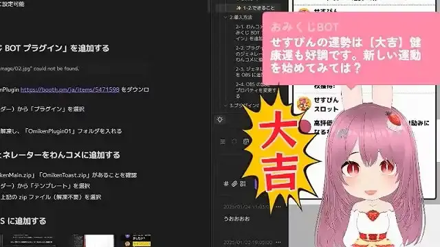
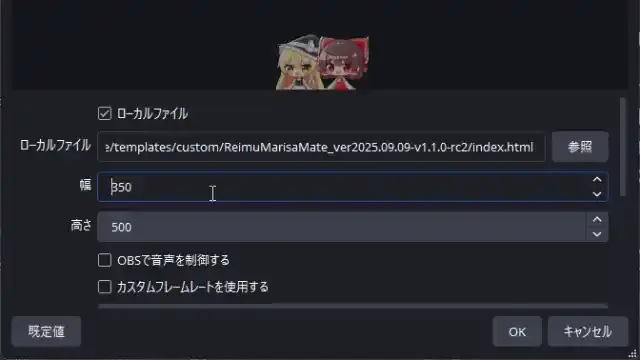
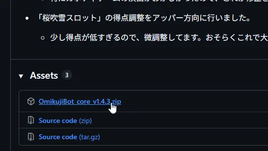
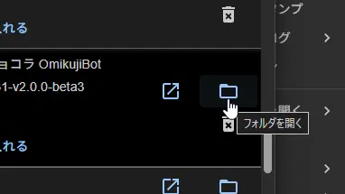
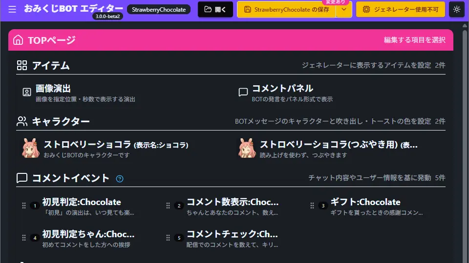

# おみくじBOT OmikujiBot

最終更新日：2026/11/26

配信者のためのコメントアプリ「わんコメ」で使用できる、BOT ソフトウェアです。

このテンプレートは、下記のパッケージの内容を含みます。

- [おみくじBOT ストロベリーショコラ OmikujiBot StrawberryChocolate](https://pintocuru.booth.pm/items/7733810)

## はじめに（Intro）

- [わんコメ](https://onecomme.com/) の機能を前提としたソフトウェアです。
- 本ソフトウェアの利用は自己責任でお願いいたします。
- 仕様は予告なく変更される場合があります。

## このテンプレートは何？（Features）

### 🎯 わんコメに BOT 機能を付与するジェネレーター

- 【おみくじBOT OmikujiBot】は、わんコメに BOT 機能を付与するジェネレーターです。
- 特定のワード (おみくじ 等) をチャットに投稿することで、ランダムな結果を配信画面に表示します。
- 初見さん (初めてのコメント) や、通算 100 回目のコメントなど、特定の条件で発動し、配信画面に表示することも可能です。

### ✨【おみくじBOT OmikujiBot】で、できること

1. **コメントに反応する【おみくじシステム】**
   - `おみくじ` とコメントすると、今日の運勢をランダムで表示
   - `じゃんけん` のような複雑なおみくじ結果も表示できる
   - `スイカジェネレーター` などのミニゲームで楽しむ
2. **[【おみくじBOT エディター】](/core/ConfigEditor/README.md) で多彩なおみくじを自作できる**
   - おみくじの内容は、自由に編集可能
   - フキダシの大きさ・色替え・アニメーションも自由に変更可能
   - わんコメの機能「WordParty」を使い、自由に演出を表示可能
3. **【初見判定ちゃん機能】で、初見さんや常連さんを判別**
   - 初めての視聴者を判別し、個別に挨拶してくれます
   - 1 週間以上の間隔が空くと、挨拶のコメントも変化します
   - 「初見詐欺」を見破る機能も搭載
4. **ギフト・メンバー限定への機能制限も可能**
   - すべてのおみくじ・ミニゲームは、ギフト限定等条件を絞ることが可能
   - メンバー、サブスク限定のおみくじの設定が可能
   - 金額に応じて、メッセージも変えられます
5. **【タイマー機能】でチャンネル登録を促す**
   - 現在の視聴数・高評価数をトーストで表示できます
   - SNS やファンクラブの告知も自動投稿
   - 投稿間隔も設定可能で、時報代わりにも使えます

## インストール (Installation)

> それぞれのパッケージに記載されている「インストール方法」をご覧ください。

### OBS でジェネレーターを表示させる際の「幅」について

- 表示サイズは柔軟に調整可能で、コンパクトにもワイドにも対応できます。
- 幅の最大値は `2xl = 42rem`（672px）、最小値は `10rem`（160px）です。
  - この範囲を外れると、はみ出しなどの表示崩れが起こる可能性があります。

### おみくじBOT のアップグレード / おみくじBOT エディターの新規導入

> 現在のバージョンは **おみくじBOT エディター** から確認できます。
> パッケージに「おみくじBOT エディター」が含まれていない場合でも、**このアップグレード手順を実行すれば新規導入として利用できます。**無料です!

#### アップグレード手順

1. GitHub から [最新バージョン](https://github.com/Pintocuru/OmikujiBotV3/releases/latest) をダウンロードします。
2. リリースノート下部の **「Assets」** から、 **「OmikujiBot_core\_」** と書かれたファイルをダウンロードします。
3. ダウンロードした ZIP ファイルを **解凍** します。

   

4. **わんコメを起動** します。
5. 「テンプレート」画面で、アップグレードしたいテンプレートを選び、右側の **「フォルダを開く」** をクリックします。
6. 解凍したファイルを、開いたフォルダへ **上書き保存** します。
7. 念のため、**おみくじBOT エディターを起動し、バージョンが最新になっているか** を確認してください。

- **注意**：アップグレード後、一部設定がデフォルトに戻る場合があります。バックアップは必ず行って下さい。

## つかいかた (Usage)

> パッケージによって、利用シーンは様々です。詳しくは、下記の Readme をご覧ください。

- [おみくじBOT ストロベリーショコラ OmikujiBot StrawberryChocolate README](/common/StrawberryChocolate/README.md)

## カスタマイズ（Customization）

### 「おみくじBOT エディター」で自由におみくじを編集できる

- 一部の配布パッケージには、**おみくじBOT エディター**（おみくじデータ編集用アプリ）が付属しています。
- アプリと同じフォルダにある **`editor.html`** を開くと起動できます。
- 詳しくは [おみくじBOT エディター README](/core/ConfigEditor/README.md) をご覧ください。

## よくある質問 (FAQ)

わんコメの機能については [よくある質問](https://onecomme.com/docs/faq) または [導入ガイド](https://onecomme.com/docs/guide) をご参照ください。

> おみくじの内容、エディター関連についての内容は [おみくじBOT エディター README](/core/ConfigEditor/README.md) の [よくある質問](/core/ConfigEditor/README.md#%E3%82%88%E3%81%8F%E3%81%82%E3%82%8B%E8%B3%AA%E5%95%8F-faq) をご覧ください。

## トラブルシューティング (Troubleshooting)

わんコメの機能については [トラブルシューティング](https://onecomme.com/docs/trouble-shooting) または [導入ガイド](https://onecomme.com/docs/guide) をご参照ください。

### 設定・表示・音声関連

- [Q. OBS 側で非表示にしていても、BOT のコメントが勝手に動いてしまう](/template/jp/troubleshooting/12_infoOmikujiBot/trouble_1202_OBSSound.md)
- [Q. キャラクター画像が表示されない](/template/jp/troubleshooting/12_infoOmikujiBot/trouble_1203_CharacterImage.md)
- [Q. WordParty の音が配信に出ない](/template/jp/troubleshooting/12_infoOmikujiBot/trouble_1206_infoWordParty.md)

### おみくじ関連

- [Q. コメントでおみくじが反応しない](/template/jp/troubleshooting/12_infoOmikujiBot/trouble_1204_CommentOmikuji.md)
- [Q. おみくじが YouTube のコメントに反映されていない](/template/jp/troubleshooting/12_infoOmikujiBot/trouble_1205_OmikujiPlatform.md)

## クレジット（Credits）

### ♫ 効果音・ジングル

- [効果音・ジングルに関するライセンス](sub/sounds.md) にまとめています。
  - このアプリに収録されている効果音データは、すべて [CC0 1.0](https://creativecommons.org/publicdomain/zero/1.0/) です。

それぞれのパッケージでは、各種イラスト素材を使用しています。詳しくは、下記の Readme をご覧ください。

- [おみくじBOT ストロベリーショコラ OmikujiBot StrawberryChocolate README](/common/StrawberryChocolate/README.md)

## ライセンス（License）

### アプリ本体（ジェネレーター・エディター・プラグイン）

- Copyright © 2023-2027 Pintocuru(せすじピンとしてます)
- 本ソフトウェア（おみくじBOT）は Apache License 2.0 の下で提供されています。
- ライセンスの条件に従う限り、本ソフトウェアの利用、複製、改変、再配布、および商用利用が可能です。
- 公式の配布場所は、GitHub、または BOOTH で提供される各パッケージです。
- パッケージに含まれるデータ・イラスト・音源は、本ライセンスの対象外です。各パッケージのライセンスをご確認ください。
- 本ソフトウェアは現状のまま（AS IS）提供されており、明示または黙示を問わず、いかなる保証も行いません。

### 効果音

- 効果音には CC0 ライセンスの素材を使用しています。
- 詳細は おみくじBOT 本体のクレジット をご確認ください。

### パッケージデータ

パッケージごとにライセンス形態（商用利用可否・改変可否など）が異なります。詳しくは各パッケージの README または商品ページをご確認ください。

## バージョン情報 (Version)

> 詳細な変更履歴は [Releases](https://github.com/Pintocuru/OmikujiBot-Docs/releases) をご覧ください。

---

作成者：Pintocuru(せすじピンとしてます) @pintocuru

[Twitter](https://twitter.com/pintocuru) | [YouTube](https://www.youtube.com/@pintocuru)
