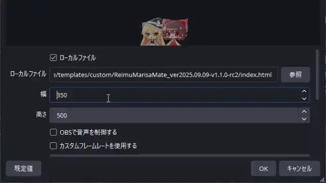

# おみくじBOT OmikujiBot

最終更新日：<% tp.date.now('YYYY/MM/DD') %>

OmikujiBot は、配信者向けコメントアプリ「わんコメ」で動作するアプリケーションを構築するソフトウェアです。共通の OmikujiBot エンジンは Generator、Console、Plugin などで構成され、配布パッケージによって搭載される機能や利用方法が異なります。

Generator は Plugin がなくても利用できます。一方、Console はユーザー管理や Generator の情報閲覧などを提供する汎用操作・管理環境で、Plugin とサーバーが必要です。Plugin は OmikujiBot 専用のわんコメプラグインで、エンジンの機能拡張や Console との連携を担います。

このテンプレートは、下記のパッケージの内容を含みます。

## はじめに（Intro）

## このアプリは何？（Features）

### 🎯 OmikujiBot エンジン

OmikujiBot エンジンは、配布パッケージの用途に応じて、次のような機能や仕組みを提供します。

- **Generator**：コメントなどのイベントを処理し、配信画面に表示する内容を生成します。Plugin がなくても利用できます。
- **Console**：ユーザー管理、Generator の情報閲覧、ゲームなどを提供する汎用操作・管理環境です。利用には Plugin とサーバーが必要です。
- **Plugin**：OmikujiBot 専用のわんコメプラグインです。サーバー API を提供し、機能拡張や Console との連携を担います。
- **Editor**：対応するパッケージでは、設定データを編集して機能や表示をカスタマイズできます。

### ✨ パッケージごとの機能

搭載されている機能はパッケージによって異なります。おみくじ、カウンター、ゲーム、ユーザー管理など、各パッケージで実際に利用できる機能や使い方については、それぞれの README をご覧ください。

## インストール (Installation)

> それぞれのパッケージに記載されている「インストール方法」をご覧ください。

### OBS でジェネレーターを表示させる際の「幅」について

- 表示サイズは柔軟に調整可能で、コンパクトにもワイドにも対応できます。
- 幅の最大値は `2xl = 42rem`（672px）、最小値は `10rem`（160px）です。
  - この範囲を外れると、はみ出しなどの表示崩れが起こる可能性があります。

### おみくじBOT のアップグレード / おみくじBOT エディターの新規導入

## つかいかた (Usage)

> パッケージによって、利用シーンは様々です。詳しくは、下記の Readme をご覧ください。

## カスタマイズ（Customization）

### 「おみくじBOT エディター」で自由におみくじを編集できる

## よくある質問 (FAQ)

> おみくじの内容、エディター関連についての内容は [おみくじBOT エディター README](/core/ConfigEditor/README.ja.md) の [よくある質問](/core/ConfigEditor/README.ja.md#%E3%82%88%E3%81%8F%E3%81%82%E3%82%8B%E8%B3%AA%E5%95%8F-faq) をご覧ください。

## クレジット（Credits）

### ♫ 効果音・ジングル

- [効果音・ジングルに関するライセンス](sub/sounds.md) にまとめています。
  - このアプリに収録されている効果音データは、すべて [CC0 1.0](https://creativecommons.org/publicdomain/zero/1.0/) です。

それぞれのパッケージでは、各種イラスト素材を使用しています。詳しくは、下記の Readme をご覧ください。

## ライセンス（License）

### アプリ本体（ジェネレーター・エディター・プラグイン）

## バージョン情報 (Version)

<%* await tp.user.expandEmbeds(tp,'ja') %>
