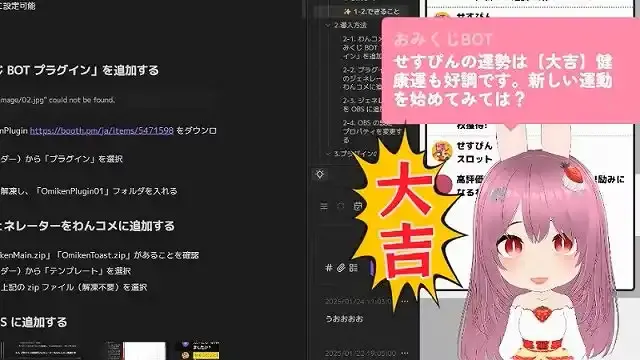

# おみくじBOT OmikujiBot

最終更新日：<% tp.date.now('YYYY/MM/DD') %>

配信者のためのコメントアプリ「わんコメ」で使用できる、BOT ソフトウェアです。

このテンプレートは、下記のパッケージの内容を含みます。

## はじめに（Intro）

## このテンプレートは何？（Features）

### 🎯 わんコメに BOT 機能を付与するジェネレーター

- 【おみくじBOT OmikujiBot】は、わんコメに BOT 機能を付与するジェネレーターです。
- 特定のワード (おみくじ 等) をチャットに投稿することで、ランダムな結果を配信画面に表示します。
- 初見さん (初めてのコメント) や、通算 100 回目のコメントなど、特定の条件で発動し、配信画面に表示することも可能です。

### ✨【おみくじBOT OmikujiBot】で、できること

1. **コメントに反応する【おみくじシステム】**
   - `おみくじ` とコメントすると、今日の運勢をランダムで表示
   - `じゃんけん` のような複雑なおみくじ結果も表示できる
   - `スイカジェネレーター` などのミニゲームで楽しむ
2. **[【おみくじBOT エディター】](/core/ConfigEditor/README.md) で多彩なおみくじを自作できる**
   - おみくじの内容は、自由に編集可能
   - フキダシの大きさ・色替え・アニメーションも自由に変更可能
   - わんコメの機能「WordParty」を使い、自由に演出を表示可能
3. **【初見判定ちゃん機能】で、初見さんや常連さんを判別**
   - 初めての視聴者を判別し、個別に挨拶してくれます
   - 1 週間以上の間隔が空くと、挨拶のコメントも変化します
   - 「初見詐欺」を見破る機能も搭載
4. **ギフト・メンバー限定への機能制限も可能**
   - すべてのおみくじ・ミニゲームは、ギフト限定等条件を絞ることが可能
   - メンバー、サブスク限定のおみくじの設定が可能
   - 金額に応じて、メッセージも変えられます
5. **【タイマー機能】でチャンネル登録を促す**
   - 現在の視聴数・高評価数をトーストで表示できます
   - SNS やファンクラブの告知も自動投稿
   - 投稿間隔も設定可能で、時報代わりにも使えます

## インストール (Installation)

> それぞれのパッケージに記載されている「インストール方法」をご覧ください。

### OBS でジェネレーターを表示させる際の「幅」について

- 表示サイズは柔軟に調整可能で、コンパクトにもワイドにも対応できます。
- 幅の最大値は `2xl = 42rem`（672px）、最小値は `10rem`（160px）です。
  - この範囲を外れると、はみ出しなどの表示崩れが起こる可能性があります。

### おみくじBOT のアップグレード / おみくじBOT エディターの新規導入

## つかいかた (Usage)

> パッケージによって、利用シーンは様々です。詳しくは、下記の Readme をご覧ください。

## カスタマイズ（Customization）

### 「おみくじBOT エディター」で自由におみくじを編集できる

## よくある質問 (FAQ)

> おみくじの内容、エディター関連についての内容は [おみくじBOT エディター README](/core/ConfigEditor/README.md) の [よくある質問](/core/ConfigEditor/README.md#%E3%82%88%E3%81%8F%E3%81%82%E3%82%8B%E8%B3%AA%E5%95%8F-faq) をご覧ください。

## クレジット（Credits）

### ♫ 効果音・ジングル

- [効果音・ジングルに関するライセンス](sub/sounds.md) にまとめています。
  - このアプリに収録されている効果音データは、すべて [CC0 1.0](https://creativecommons.org/publicdomain/zero/1.0/) です。

それぞれのパッケージでは、各種イラスト素材を使用しています。詳しくは、下記の Readme をご覧ください。

## ライセンス（License）

### アプリ本体（ジェネレーター・エディター・プラグイン）

### 効果音

### パッケージデータ

## バージョン情報 (Version)

<%* await tp.user.expandEmbeds(tp,'ja') %>
