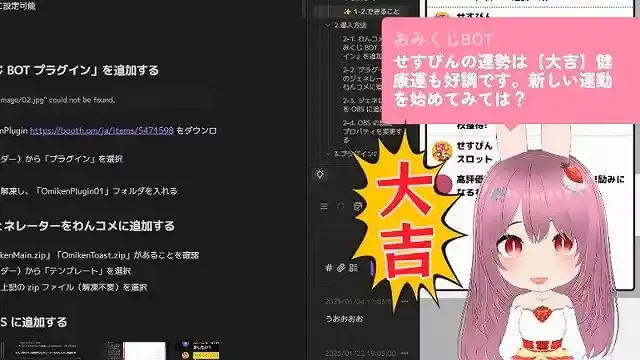
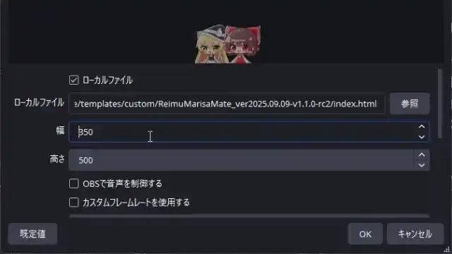

# OmikujiBot

Last updated: <% tp.date.now('YYYY/MM/DD') %>

 BOT software.

This template is included in the following packages.

## What is this template? (Features)

### 🎯 A generator that gives OneComme BOT features

- "OmikujiBot" is a generator that adds BOT features to OneComme.
- When someone posts a specific word (such as "おみくじ") in chat, a random result is shown on your stream screen.
- It can also trigger under specific conditions, such as for first-time viewers (their first-ever comment) or a viewer's 100th comment overall, and display something on your stream screen.

### ✨ What you can do with "OmikujiBot"

1. **An "omikuji system" that reacts to comments**
   - Comment `おみくじ` and today's fortune is shown at random
   - It can also show complex omikuji results, like `じゃんけん` (rock-paper-scissors)
   - Enjoy mini-games such as the `スイカジェネレーター` (Watermelon Generator)
2. **Create a wide variety of omikuji yourself with [OmikujiBot Editor](/core/ConfigEditor/README.md)**
   - The omikuji content is freely editable
   - Speech bubble size, colors, and animations can also be freely changed
   - Use OneComme's "WordParty" feature to freely display effects
3. **Tell first-timers and regulars apart with the "First-Timer Detector"**
   - It recognizes first-time viewers and greets them individually
   - The greeting changes if more than a week has passed since their last visit
   - It even has a feature to catch "first-timer fraud"
4. **Restrict features to gifts or members**
   - Every omikuji and mini-game can be limited by conditions such as gifts only
   - You can set omikuji for members or subscribers only
   - Messages can also change depending on the amount
5. **Encourage channel subscriptions with the "Timer feature"**
   - It can show the current view count and like count as a toast
   - It also auto-posts announcements for social media or fan clubs
   - The posting interval is configurable, so it can even be used as a time signal

## Installation

> See the "Installation" instructions in each package.

### About the "Width" When Displaying the Generator in OBS

- The display size is flexible and can be adjusted from compact to wide.
- The maximum width is `2xl = 42rem` (672px), and the minimum is `10rem` (160px).
  - Outside this range, the display may break, with content overflowing.

## Usage

> Usage scenarios vary by package. For details, see the Readme below.

## Frequently Asked Questions (FAQ)

> For omikuji content and editor-related questions, see the [Frequently Asked Questions](/core/ConfigEditor/README.md#frequently-asked-questions-faq) in the [OmikujiBot Editor README](/core/ConfigEditor/README.md).

### How do I check a "first-time comment" in the Comment Tester?

- (TODO:ここを書く)

### Q. What does "Omiken" mean?

A: It comes from omikuji + syoken (first-timer). It's a remnant of the previous work, "[Shoken-Hantei-chan](https://booth.pm/ja/items/5471598)".

## Credits

### ♫ Sound Effects and Jingles

- They are compiled in [License for sound effects and jingles](sub/sounds.md).
  - All sound effect data included in this app is [CC0 1.0](https://creativecommons.org/publicdomain/zero/1.0/).

Each package uses various illustration materials. For details, see the Readme below.

## Version Information

> For the detailed change history, see [Releases](https://github.com/Pintocuru/OmikujiBot-Docs/releases).

<%* await tp.user.expandEmbeds(tp) %>
