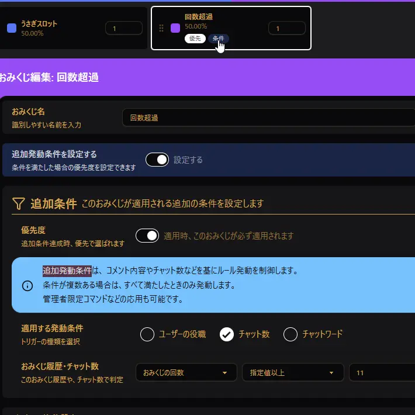

## Q. I want to limit how many times it can be used, such as once per day

1. In OmikujiBot Editor, open Comment Events > Omikuji Settings.
2. Click the "Add Omikuji" button to create a new omikuji.
3. Turn ON "Set additional trigger conditions" and enter the additional condition.
   1. Priority: ON
   2. Trigger condition to apply: Chat count
   3. Omikuji history / chat count: Number of omikuji draws / at least the specified number / the number you want
4. Under "Action", select `Special Action`.
5. Under "Special Action Type", select `End Processing`.
