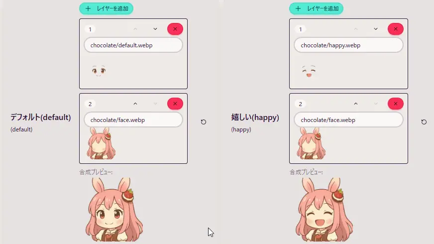

## Q. I want to add my own character images

Customizing with your own original character images is welcome. Follow the steps below to easily add your own character.

### 1. Create new character data

1. In **OmikujiBot Editor**, open **"Characters"**.
2. Click **"+ Add"** to create new character data.
3. Enter the following basic information in the top tabs.
   - **key**: Enter alphanumeric characters. The name you set here becomes **the base of the image file names**.
   - **Setting name**: A name for management (something easy to identify).
   - **Description**: A note for management.
   - **Display name in the Generator**: The name shown on screen (can be left blank).
4. Adjust **Speech Bubble Color Settings** and **BOT Comment Expression Settings** as needed.
5. Open **"Image Settings for Generator"** and assign images.

### 2. Place the image files

1. Place the image files beforehand in the `Characters/[characterID]` folder.
   - Example: `Characters/reimu/default.webp`
   - Because images are referenced locally, **drag and drop is not supported**.
2. The file names you can use are fixed: **12 types**, such as `default.png`, `happy.png`, and `laughing.png`.
   - Supported formats: png / jpg / jpeg / gif / webp
3. Clicking the **image switch button** for each item cycles the **extension** in order, like `[characterID]/[emotion].png → .gif → .webp …`
   - Keep clicking until you reach the extension you want.

### About the Layer Feature

- You can **stack multiple images** for each emotion.
- In the array, **index 0 is the front-most**; the larger the number, the further back it is displayed.

### About Image Size (Recommended)

- **1:1 (square)** is recommended for character images.
  - Rectangular images can also be used, but **the center is automatically cropped**.
- Character images up to **about 320px** are supported.
- The recommended size is **320px by 320px**.
  - Larger images can still be loaded, but **needlessly large images may increase memory usage or slow loading**.
- Since images can be scaled in OBS, keeping them at a **moderate size in the app** makes them easier to handle.
