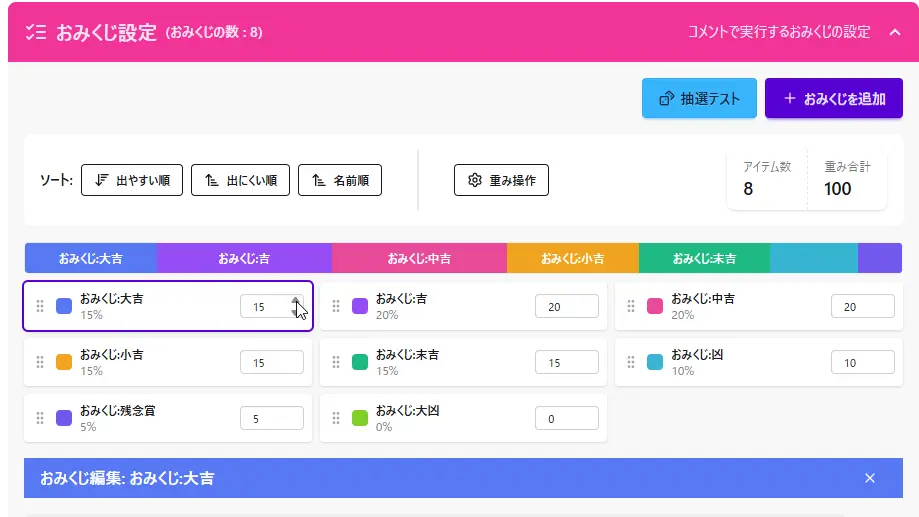

## Q. I want to change the probability of omikuji appearing

- In "**Omikuji Settings**", you can **select the omikuji item** whose probability you want to change.
- By changing each item's value (weight), you can **freely adjust how often it appears**.
  - Values are shown as percentages, so you can see the current appearance rate at a glance.
  - Setting the value to **0** means that omikuji **will no longer appear**.
