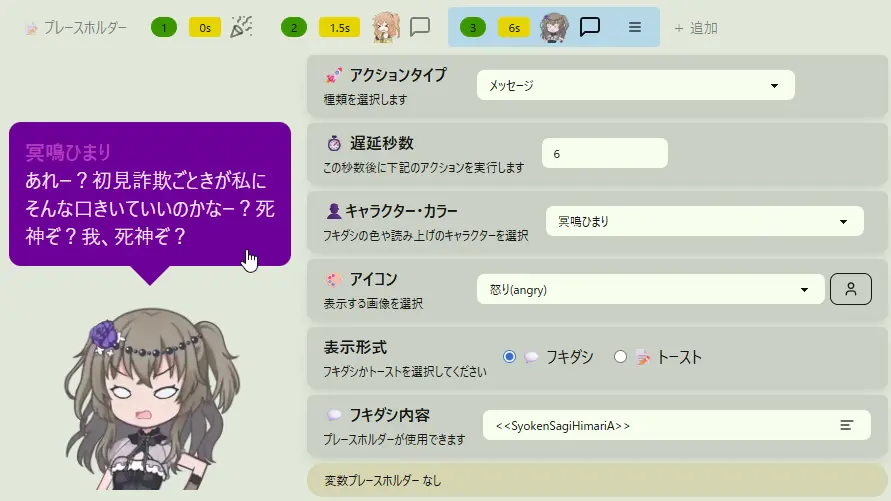

## Q. How do I check omikuji behavior in the editor?

- This feature is available in **Comment Events, Timer Events, and Action Sets alike**.
- "**Omikuji Settings**" has a **preview** on the left where you can check the actual display.
- If you have set placeholders or evaluation blocks and they are written correctly, **the converted text is reflected in the preview**.
  - If there is a mistake, the text is not converted and is shown as written, which helps you check whether it is written correctly.
  - If you use a reserved word for placeholders, it is converted to the corresponding content.
  - Example: `<<user>>さん、<<hello>>` → `[User name]さん、今日もいい天気ですね`
- If a placeholder has multiple candidates, **one is chosen at random and displayed**.
  - In this case, **weights (probability settings) are not applied; the choice is completely random**.
