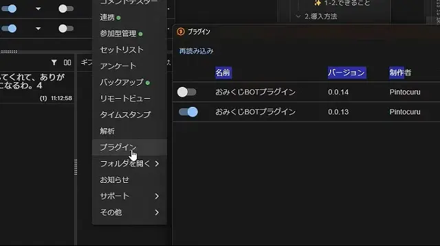

### Installing the Plugin in OneComme

1. Download the plugin from the download page.
2. Unzip the downloaded zip file.
3. Launch OneComme and select "Plugins" from the [...] button at the top right of the main screen.
4. Click "Plugin Folder" at the top right of the Plugins window to open the folder.
5. Put the unzipped folder into this plugin folder.
6. Click the "Reload" button in the plugin list and turn on the switch for the plugin.
