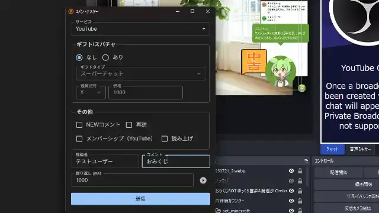

### How to Trigger Omikuji

- Before using it on a real stream, we recommend **checking that it works with OneComme's Comment Tester**.
- To use the Comment Tester, select "Comment Tester" from OneComme's menu.
- If the Generator (`index.html`) is correctly installed in OBS or another streaming app, sending a keyword such as "おみくじ" in a comment will trigger it.
