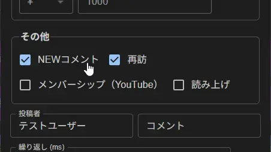

### First-Timer Detector (Shoken-Hantei-chan)

> Trigger condition: first comment

- Greets people on their first-ever comment, when they return after a long time (about 1 week), and on their first comment in that stream.
  - Detection uses OneComme's data.
  - Therefore, even if someone is not actually a "first-timer", they will be treated as one if there is no user information in the data. Thank you for your understanding.
- What happens if someone who isn't a first-timer comments "初見" (first time here)...?

#### How to Test in the Comment Tester

- In OmikujiBot v1.2 and later, you can test the "First-Timer Detector" by checking the following under "Other" in the Comment Tester.
  - `NEWコメント`: First-timer
  - `NEWコメント` + `再訪`: Welcome back (1 week or more since their last comment)
  - `再訪`: First comment in the stream

#### First-Timer Fraud ("初見詐欺")

> Trigger words: `初見(?!さん)` / `所見` / `はじめまして`
> Trigger condition: when the individual's total comment count is 6 or more

- Replies with a comeback to users who comment "初見" (first time here) even though they are not actually first-timers.
  - If the comment count is 5 or fewer, there is also a lenient version called "True First-Timer".
- If someone uses multiple accounts, OneComme cannot tell that it is the same person across different accounts, so they will be treated as a first-timer.
