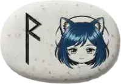
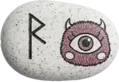
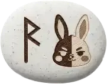

### Rune Divination

> Trigger words: `ルーン` / `rune` / `runic` / `占い`

- Uses the **24 runes** of the ancient Germanic alphabet. A divination feature where the meaning symbolized by a single rune gives you the hint you need right now.
  - It's simple to draw, and may offer insights that help you sort out a situation or shift your mood.
  - If you install [WordParty for OmikujiBot](https://booth.pm/ja/items/6048048) too, animations play when it runs.

|  |  |  |
| --------------------------------------------- | --------------------------------------------- | --------------------------------------------- |

- The characters on the cards are OmikujiBot's characters. From left to right, their names are:
  - Mint = Syrup Bottle
  - Mamono = Açaí Bowl
  - Capellate = Float
