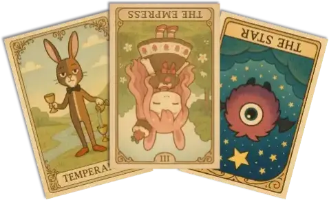

### Tarot Cards

> Trigger words: `タロット` / `タロットカード` / `tarot`

- Uses the 22 Major Arcana cards. There are 44 possible results in total, including upright and reversed positions.
  - The card meanings are the real deal. Even if you draw casually, something might stay with you.
  - If you install [WordParty for OmikujiBot](https://booth.pm/ja/items/6048048) too, animations play when it runs.

- The characters on the tarot cards are OmikujiBot's characters. From left to right, their names are:
  - Capellate = Float
  - Strawberry Chocolat
  - Mamono = Açaí Bowl
