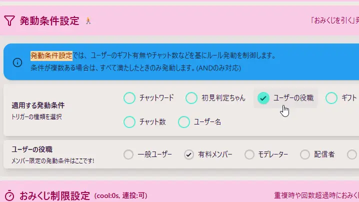

## Q. メンバー限定で発動させたい

1. おみくじBOT editorから、 コメントイベント ＞ 発動条件設定 を開く
2. 「適用する発動条件」から「ユーザーの役職」を選択
3. 適用したいユーザーに合わせ選択します
   1. 「有料メンバー」は、以下を参照していますが、メンバー機能があれば、下記以外でも適用できる可能性があります（申し訳ないですが未確認です）
   2. YouTube : メンバー
   3. Twitch : サブスクライブ
   4. ニコニコ生放送 : プレミアム会員 (フォロワーではないです)
