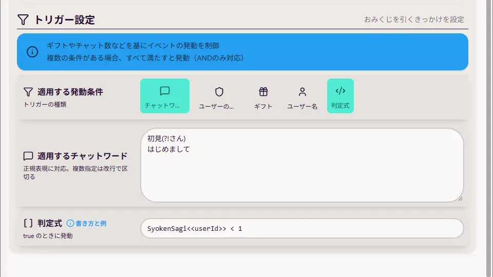

## Q. 1ユーザーにつき、1 日 1 回と、回数を制限したい

「評価ブロック」という仕組みを使うことで、回数のカウントを自在に行うことができます。

詳細は [判定式(コメントの発動条件)](https://github.com/Pintocuru/OmikujiBotV3/blob/main/docs/core/ConfigEditor/sub/TriggerExpression.md) を、生成AIに読み込ませてみてください
