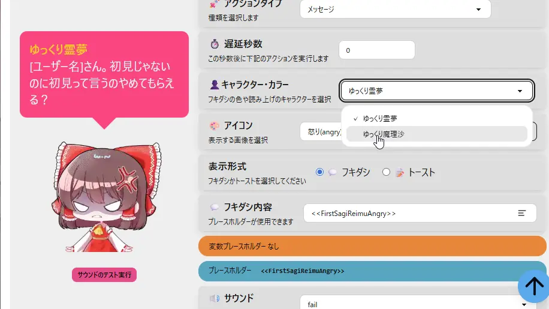
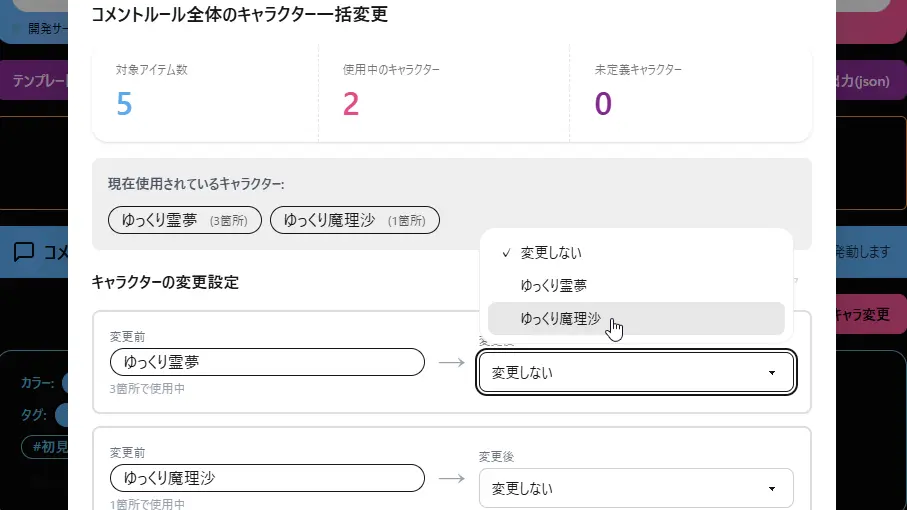

## Q. おみくじ結果で表示されるキャラクター・アイコンを変更したい

### 特定のおみくじを変更する

- この設定は、コメントイベント・タイマーイベント・アクションセット共通です。
- 「おみくじ設定」 の、キャラクター・カラー から変更できます。
  - キャラクターモードが OFF であるときは、この項目は表示されません。
  - 詳しくは [Q. キャラクターを表示したい / キャラクターを消してフキダシだけにしたい](/template/faq/22_Character/faq_2202_BubbleOnly.md) をご覧ください。

### すべてのおみくじから、一括で変更する

- この設定は、コメントイベント・タイマーイベント・アクションセット共通です。
- 各項目欄にある、「全体キャラ変更」 「キャラ変更」ボタンを押します。
- 「キャラクターの変更設定」から、任意のキャラクターを指定し「変更を実行」します。
