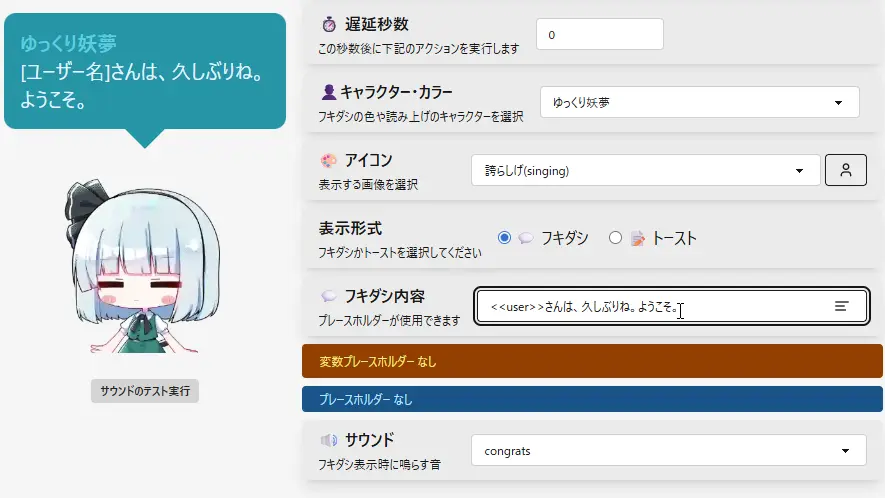

## Q. おみくじの内容を変更したい

- この設定は、コメントイベント・タイマーイベント・アクションセット共通です。
- 「おみくじ設定」 の、フキダシ内容 から変更できます。
  - 内容には、以下の機能が使用できます。
  - [評価ブロック](/core/ConfigEditor/sub/VariablePlaceholder.md)
  - [プレースホルダー](/core/ConfigEditor/sub/ContentPlaceholder.md)
