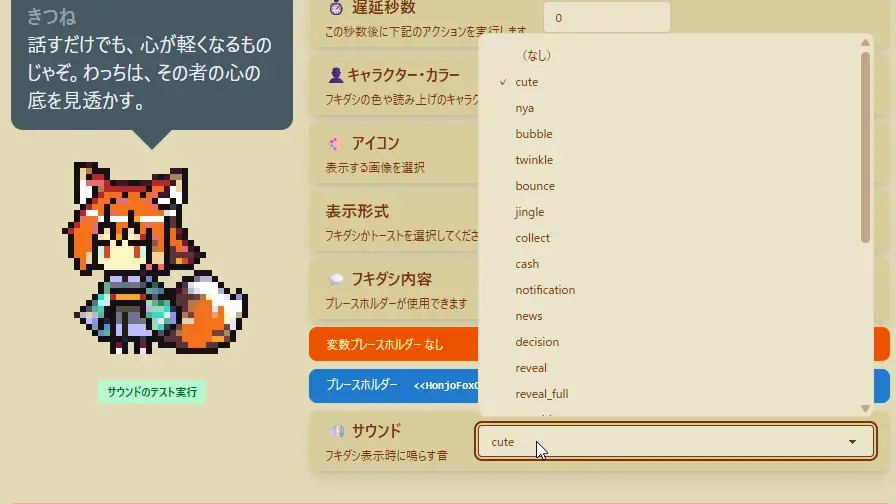

## Q. おみくじ表示時、好きなサウンドを鳴らすには

### プリセットから鳴らす

- この設定は **コメントイベント・タイマーイベント・アクションセット共通** で利用できます。
- 「**おみくじ設定**」のアクションタイプが **「メッセージ」** または **「サウンド」** の場合に設定が可能です。
  - プリセットで使用しているサウンドは、すべて **CC0 ライセンス** の素材です。
  - サウンドのライセンスは [効果音・ジングルに関するライセンス](/core/OmikujiBot/sub/sounds.md) をご覧ください。
- サウンドの動作を確認したい場合は、左側のプレビューにある **「サウンドのテスト実行」** を押すことで再生できます。

### ユーザー独自の音声を鳴らすには

- assets/sounds から、mp3 または ogg ファイルを入れます。
- (TODO:ファイルパスを入力する項目名を書く) に、該当するファイルのパスを手入力します。
- 「サウンドのテスト実行」で鳴れば成功です。
