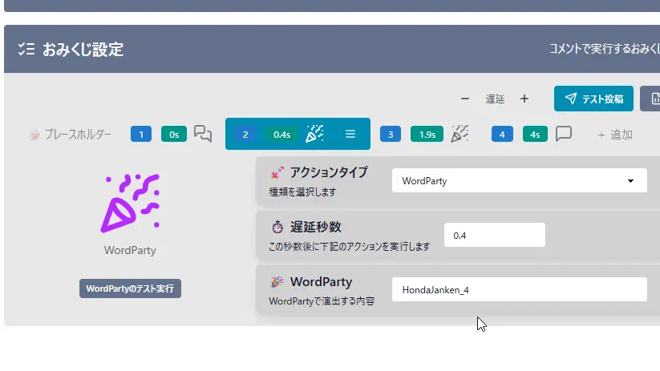
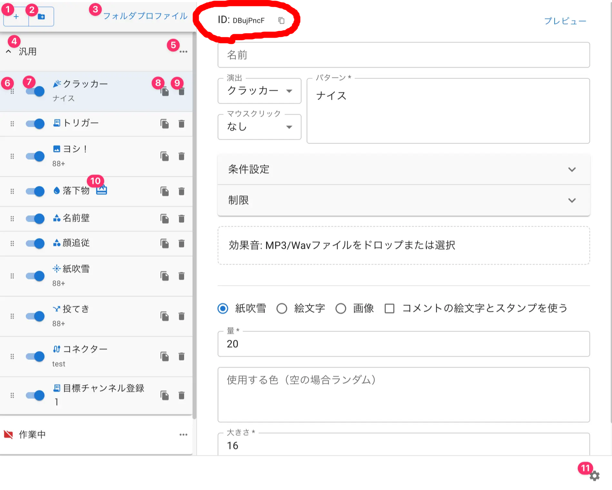

## Q. おみくじ表示時に WordParty を鳴らす

- 「**おみくじ設定**」のアクションタイプが **「WordParty」** の場合に設定が可能です。
- 任意の WordParty テンプレートで設定した **「パターン」** に一致する文章を入力すると、その WordParty の演出が実行されます。
  - **WordParty の ID のみ対応**しており、**パターン一致では反応しません**。
  - パターンの仕様は わんコメ公式 [WordPartyエディターの見方と設定](https://onecomme.com/docs/feature/wordparty-editor) をご覧ください

### WordParty の ID はどこですか？

(TODO:ID の場所を文章でも説明する)

### 設定時の注意点

- 各パッケージには、専用 WordParty **「おみくじBOT 用 WordParty 2.0」** を起動させるためのパターンがあらかじめ記載されています。
  - このパターンを変更すると、**本来の演出が発動しなくなる可能性があります**。
  - 特に、キャラクター演出・フキダシ演出・サウンド演出など、パッケージ固有の動作に影響するため、編集する際は慎重に扱ってください。
- もし独自の WordParty を追加したい場合は、既存のパターンと衝突しないように、**固有のパターン名**を設定するのがおすすめです。
