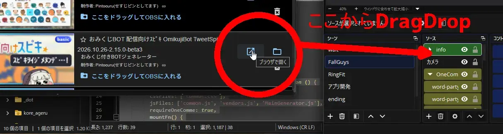

# OBS 33 以降での導入方法

OBS 33 以降では、セキュリティ強化により、**ローカルファイル(`file://`)として読み込んだページから わんコメ への通信が遮断されます**。

そのため、わんコメの推奨とは異なる手順で OBS に追加する必要があります。

## 手順

わんコメの「テンプレート」画面で、次の操作を行ってください。

1. 対象のテンプレートを探します。
2. ❌ **「ここをドラッグしてOBSに入れる」は使わないでください。**
3. ✅ その**右隣にある「ブラウザで開く」**を、OBS の**ソース**へドラッグして入れてください。

## なぜこの手順なのか

「ブラウザで開く」から追加すると、ソースの URL が `http://localhost/…` になります。

この形であれば、OBS 33 以降でも わんコメ との通信が遮断されず、正常に動作します。

「ここをドラッグしてOBSに入れる」で追加した場合は、ローカルファイルとして読み込まれるため、通信が遮断されます。

## すでに「ここをドラッグしてOBSに入れる」で追加している場合

1. OBS のソースを右クリックし、「プロパティ」を開く。
2. 上記の手順で追加し直す(古いソースは削除してください)。

テンプレートが「導入方法の確認が必要です」と表示している場合も、この手順で解決します。

## 困ったときは

- わんコメが起動しているか確認してください。
- OBS の「ログの表示」でコンソールログを確認してください。
