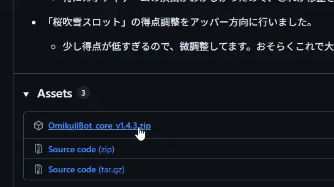
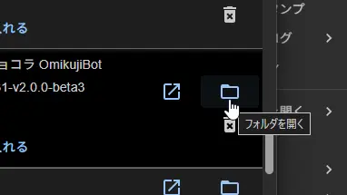

### おみくじBOT のアップグレード / おみくじBOT editor の新規導入

> 現在のバージョンは **おみくじBOT editor** から確認できます。
> パッケージに「おみくじBOT editor」が含まれていない場合でも、**このアップグレード手順を実行すれば新規導入として利用できます。**

#### アップグレード手順

1. GitHub から [最新バージョン](https://github.com/Pintocuru/OmikujiBot-Docs/releases/latest) をダウンロードします。
2. リリースノート下部の **「Assets」** から、 **「OmikujiBot_core\_」** と書かれたファイルをダウンロードします。
3. ダウンロードした ZIP ファイルを **解凍** します。

4. **わんコメを起動** します。
5. 「テンプレート」画面で、アップグレードしたいテンプレートを選び、右側の **「フォルダを開く」** をクリックします。
6. 解凍したファイルを、開いたフォルダへ **上書き保存** します。
7. 念のため、**おみくじBOT editorを起動し、バージョンが最新になっているか** を確認してください。

- **注意**：アップグレード後、一部設定がデフォルトに戻る場合があります。バックアップは必ず行って下さい。
